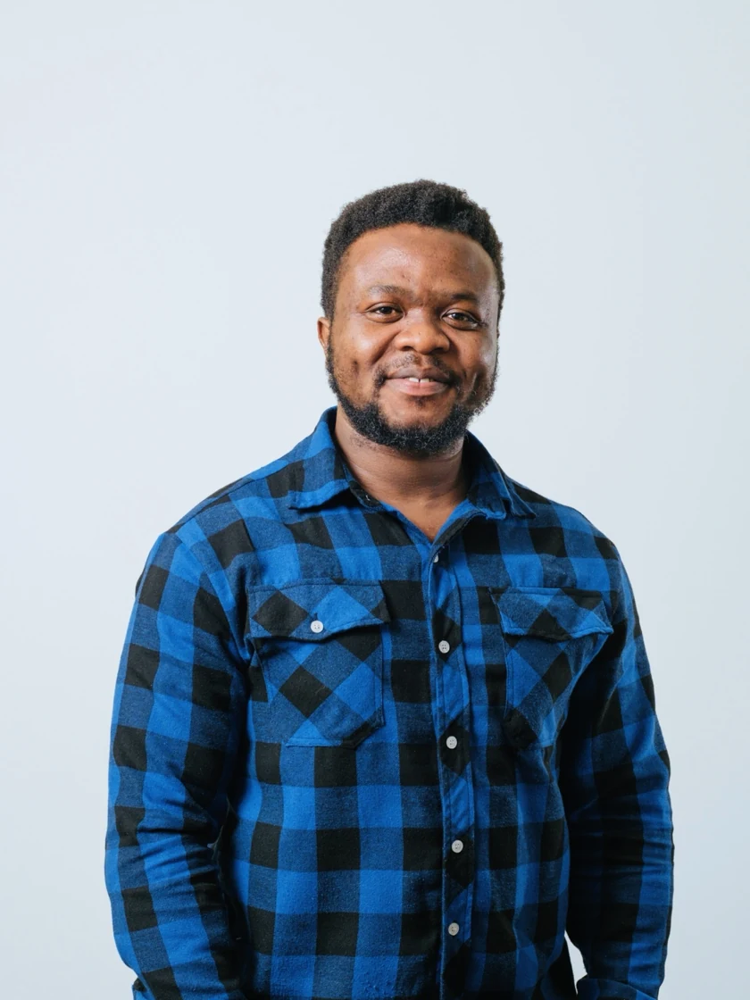

```{=html}
<div class="site-wrap home-wrap">
  <section class="hero-grid" aria-labelledby="home-title">
    <div class="hero-copy">
      <p class="eyebrow"><span class="eyebrow-line"></span> FORESTRY · CLIMATE RESILIENCE · ENVIRONMENTAL ECONOMICS</p>
      <h1 id="home-title">Fallah<br><em>Nyumah.</em></h1>
      <p class="hero-role">PhD Candidate in Forestry</p>
      <p class="hero-institution">Institute of Forestry and Conservation<br>University of Toronto, Canada</p>
      <p class="hero-lede">I investigate how oil palm and rubber plantations can remain productive, climate-resilient, and environmentally responsible under changing conditions.</p>
      <p class="hero-support">My work brings together process-based modelling, techno-economic analysis, life-cycle assessment, and decision-support systems, building on experience in forest conservation, environmental policy, and teaching.</p>
      <div class="button-row">
        <a class="btn-primary-custom" href="research.html">Explore my research <span aria-hidden="true">↗</span></a>
        <a class="btn-outline-custom" href="cv.html">Academic profile <span aria-hidden="true">→</span></a>
      </div>
    </div>
    <div class="hero-portrait-col">
      <figure class="portrait-frame">
        
        <figcaption class="portrait-caption"><span class="caption-dot"></span> Research focus: sustainable plantation systems</figcaption>
      </figure>
      <div class="floating-label" aria-hidden="true"><span>LIBERIA</span><b>Research<br>in context</b><span class="floating-arrow">↗</span></div>
    </div>
  </section>

  <section class="profile-highlights" aria-label="Academic highlights"><div><span class="tiny-label">ACADEMIC TRAINING</span><strong>PhD Candidate in Forestry</strong><small>University of Toronto · Forestry</small></div><div><span class="tiny-label">SCHOLARLY OUTPUTS</span><strong>Peer-reviewed research &amp; thesis</strong><small>Forest communities · waste management · education</small></div><div><span class="tiny-label">PROFESSIONAL EXPERIENCE</span><strong>Teaching · Research · Climate policy</strong><small>University of Toronto · UNFCCC · Liberia</small></div></section>

  <section class="intro-band" aria-label="Research vision">
    <span class="tiny-label">RESEARCH VISION</span>
    <p>Linking the <em>science of plantation systems</em> with the economics and environmental evidence needed for informed decisions.</p>
    <span class="thin-arrow" aria-hidden="true">↘</span>
  </section>

  <section class="content-section" aria-labelledby="focus-heading">
    <div class="section-heading">
      <div><p class="eyebrow">WHAT I STUDY</p><h2 id="focus-heading">Research focus</h2></div>
      <a class="text-link" href="research.html">View the research program <span aria-hidden="true">↗</span></a>
    </div>
    <div class="focus-grid">
      <article class="focus-card"><span class="card-number">01 / SYSTEMS</span><div class="focus-glyph glyph-tree" aria-hidden="true">⌁</div><h3>Plantation growth and yield</h3><p>Simulating oil palm and rubber productivity, biomass development, water use, and carbon dynamics.</p><a href="research.html#process-based-modelling" class="inline-link">Explore topic <span aria-hidden="true">→</span></a></article>
      <article class="focus-card"><span class="card-number">02 / IMPACTS</span><div class="focus-glyph" aria-hidden="true">◉</div><h3>Climate and environmental change</h3><p>Understanding climate sensitivity, yield risk, greenhouse-gas pathways, and environmental trade-offs.</p><a href="research.html#climate-risk-and-carbon" class="inline-link">Explore topic <span aria-hidden="true">→</span></a></article>
      <article class="focus-card"><span class="card-number">03 / DECISIONS</span><div class="focus-glyph" aria-hidden="true">↗</div><h3>Economic and decision analysis</h3><p>Connecting plantation scenarios to economic appraisal, life-cycle assessment, and practical decision tools.</p><a href="research.html#assessment-and-decision-support" class="inline-link">Explore topic <span aria-hidden="true">→</span></a></article>
    </div>
  </section>

  <section class="program-section" aria-labelledby="program-heading">
    <div class="program-text"><p class="eyebrow eyebrow-light">DOCTORAL RESEARCH</p><h2 id="program-heading">Climate-resilient oil palm and rubber plantations in Liberia.</h2><p>An integrated research program moving from biological simulation to environmental and economic assessment, and finally to decision support.</p><a class="light-link" href="research.html">See the research framework <span aria-hidden="true">↗</span></a></div>
    <div class="method-list" aria-label="Research program components"><div><span>01</span><strong>Evidence synthesis</strong><small>Literature and research gaps</small></div><div><span>02</span><strong>3PG-RubPalm</strong><small>Process-based simulations</small></div><div><span>03</span><strong>TEA &amp; LCA</strong><small>Economic and environmental outcomes</small></div><div><span>04</span><strong>Decision-support systems</strong><small>Management pathway assessment</small></div></div>
  </section>

  <section class="content-section tools-feature" aria-labelledby="tools-heading">
    <div class="section-heading"><div><p class="eyebrow">FROM RESEARCH TO APPLICATION</p><h2 id="tools-heading">Research models &amp; tools</h2></div><a class="text-link" href="tools.html">Explore tools <span aria-hidden="true">↗</span></a></div>
    <div class="tool-mini-grid">
      <article class="tool-mini"><span class="tool-symbol" aria-hidden="true">3PG</span><div><p class="tiny-label">PROCESS-BASED MODEL</p><h3>3PG-RubPalm</h3><p>Growth, productivity, and carbon simulations for oil palm and rubber plantations.</p></div></article>
      <article class="tool-mini"><span class="tool-symbol" aria-hidden="true">CO₂</span><div><p class="tiny-label">GHG ACCOUNTING</p><h3>LiRubPalm-GHG</h3><p>Climate and greenhouse-gas impact assessment for plantation scenarios.</p></div></article>
      <article class="tool-mini"><span class="tool-symbol" aria-hidden="true">DSS</span><div><p class="tiny-label">DECISION SUPPORT</p><h3>Liberia Plantation DSS</h3><p>Comparing management and adaptation pathways through integrated evidence.</p></div></article>
    </div>
    <p class="small-note">Research software is under development. Public demonstrations will be linked after release and documentation review.</p>
  </section>

  <section class="feature-quote" aria-labelledby="current-work"><div><p class="eyebrow">CURRENT WORK</p><h2 id="current-work">Growth, Yield, and Carbon Dynamics of Oil Palm and Rubber Plantations Under Liberian Climatic Conditions</h2><p>Current manuscript in preparation · Process-based plantation modelling</p></div><a class="text-link" href="publications.html">Publications &amp; research outputs <span aria-hidden="true">↗</span></a></section>

  <section class="closing-cta" aria-labelledby="cta-heading"><div><p class="eyebrow">COLLABORATION</p><h2 id="cta-heading">Connecting research with practice.</h2><p>Interested in plantation sustainability, environmental economics, climate adaptation, or research modelling?</p></div><a class="btn-primary-custom" href="contact.html">Connect &amp; collaborate <span aria-hidden="true">↗</span></a></section>
</div>
```
